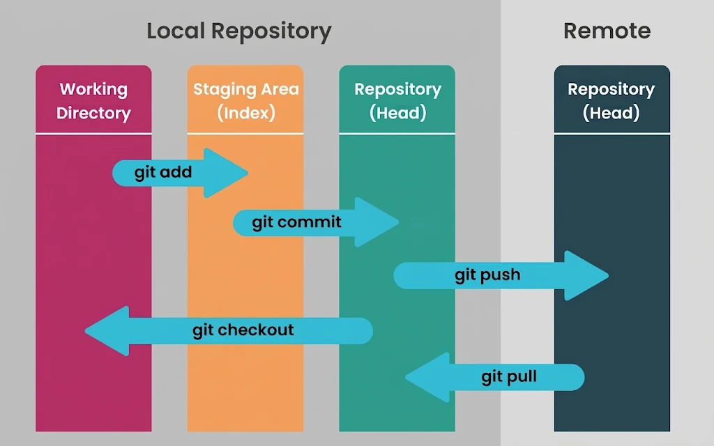
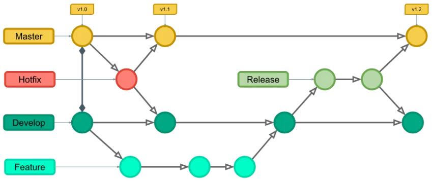
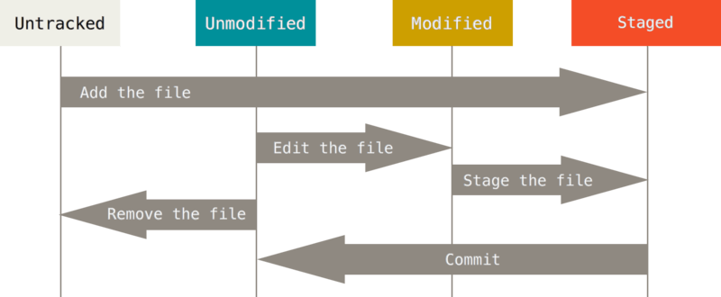

# Git e GitHub

### Git Fundamental

#### Repositórios
- `git init` → inicia o repositório 
- `git clone` → clona um repositório do github
- `git remote add origin` → associa o repositório remoto como `origin`
  - Ex: `git remote add origin url_repo`

#### Alterações
- `git status` → mostra arquivos modificados/preparados
- `git add` → adiciona alterações à área de staging
  - Ex: `git add .` → prepara todas as alterações 
  - Ex: `git add pasta/arq` → prepara um arquivo 
- `git commit` → registra as alterações preparadas
  - Ex: `git commit -am "msg"` → adiciona automaticamente todos arquivos já rastreados
- `.gitignore` → define arquivos e pastas que não serão rastreados
  - Ex: adicionar `node_modules/` ao `.gitignore`

#### Histórico
- `git log` → mostra o histórico de commits
  - Ex: `git log --oneline` → resume cada commit em uma linha
- `git show` → exibe as alterações de um commit
  - Ex: `git show HEAD`

#### Arquivos
- `git rm` → remove um arquivo
  - Ex: `git rm arq.txt`
- `git mv` → renomeia um arquivo
  - Ex: `git mv antigo.txt novo.txt`

#### Sincronização
- `git push` → envia commits locais ao remoto
  - Ex: `git push -u origin main` → define `origin main` como destino padrão
- `git pull` → atualiza a branch atual com alterações do remoto
  - Ex: `git pull origin main`

#### Desfazer alterações
- `git checkout -- arq` → descarta as modificações feitas que ainda não foram salvas em um commit
- `git reset --soft HEAD~1` → desfaz o último commit sem perder as alterações
- `git reset --hard origin/main` → restaura `origin/main` e descarta alterações locais

#### Git Workflow

### Branches

#### Branch
- `git branch` → lista todos os branches
- `git branch nome_branch` → cria um novo branch a partir do branch atual
- `git -d branch` → deleta um branch (não é comum deletar branches)
  - `git --delete branch` → usado quando o brach foi criado errado
- `git checkout nome` → muda de branch
  - `git checkout -b nome` → cria um novo branch e muda para ele
  - **alterações não commitadas podem ser levadas junto**
- `git merge nome_branch` → junta o código à branch que vai receber as alterações
  - por ele que recebe atualizações de outros devs

#### Stash
- `git stash` → salva modificações atuais para prosseguir com uma outra abordagem sem perder o código (como uma lixeira)
  - o branch será resetado
- `git stash list` → lista todas as stashs criadadas
- `git stash show -p num_stash` → mostra as alterações da stash 
- `git stash apply num_stash` → recupera uma stash 
- `git stash clear` → limpa todas as stashs
- `git stash drop num_stash` → remove uma stash específica

#### Tag
- `git tag -a nome_tag -m "msg"`
  - serve como um checkpoint de um branch → demarcar estágios de desenvolvimento de algum recurso
  - sempre dar `git commit` 
- `git tag` → lista todas as tags
- `git show nome_tag` → verifique os detalhes e alterações
- `git checkout nome_tag` → trocar de tag
- `git push origin nome_tag` → envia a tag ao repositório
  - `git push origin --tags` → envias todas as tags

#### Git Flow

### Compartilhamento e Atualização de Repositórios
- `git fetch -a` → recebe todos os branchs e tags criados por outros devs
  - primeiro → `git checkout nome_branch`
  - depois → `git branch` (só agora aparece o novo branch)
- `git pull` → recebe as atualizações de outros devs
- `git push` → envia as atualizações de um branch específico para o repo remoto
- `git remote -v` → verificar origens
  - `git remote rm -v` → remove as origens
  - `git remote add origin url_repo` → adiciona a origem
- Submódulos: permite ter 2+ projetos num único repositório
  - `git submodule add url_repo2` → adiciona um outro repositório como submódulo
  - `git submodule` → lista todos os submódulos
  - **ainda são projetos independentes**
  - `git push --recursive-submodules=on-demand` → envia somente as mudanças do submódulo

#### Ciclo de Vida de Arquivos

  
### GitHub
- **Issues** → registra bugs, tarefas e sugestões
- **Pull Requests** → propõe alterações para revisão e inclusão no repositório
- **Actions** → automatiza tarefas do repositório
  - **CI**/**CD** → executa testes e publica atualizações automaticamente
- **Projetos** → organiza tarefas e acompanha o andamento do trabalho
- **Wiki** → reúne documentação do projeto
- **Insights** → apresenta dados e métricas sobre o repositório
- **Settings** → configura o repositório e gerencia acessos
- **Gist** → compartilha trechos de código ou outros arquivos
