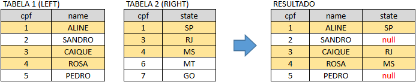
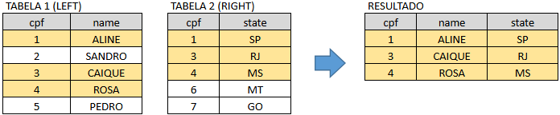
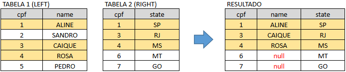
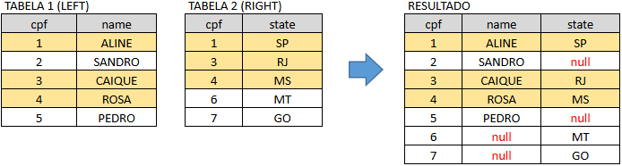

# SQL

- Baseado no curso "SQL para Análise de Dados: Do básico ao avançado", de Midori Toyota (Udemy).
- Ambiente: PostgreSQL

### Funções de Agregação

* Count()
* Sum()
* Min()
* Max()
* Avg()

### Group By

* Normalmente utilizado com funções de agregação, mas não necessariamente
  * ```SQL
    -- Sem as funções de agregação → funciona como um DISTINCT
    SELECT state FROM sales.customers
    GROUP BY state
    ```
* Group By +1 coluna:
  * ```SQL
    SELECT state, professional_status, COUNT(*) AS contagem
    FROM sales.customers
    GROUP BY state, professional_status
    ORDER BY state, contagem DESC
    ```

### Having

* Filtra linhas de colunas agrupadas por funções de agregação e também colunas não agrupadas
  * ```SQL
    SELECT state, COUNT()
    FROM sales.customers
    GROUP BY state
    HAVING COUNT() > 100 AND state <> 'MG'
    ```

### Joins

* Left Join
  * 
* Inner Join
  * 
* Right Join
  * 
* Full Join
  * 

### Unions

* Union

  * Remove linhas duplicadas (+ pesado)
* Union ALL

  * Não remove linhas duplicadas
  * ```SQL
    select * from sales.products
    ```

### Subqueries

* WHERE

  * A subquerie deve retornar apenas um valor
  * Quando é preciso filtrar registros usando o resultado de outra consulta
  * ```SQL
    -- Informe qual é o veículo mais barato da tabela products
    SELECT * FROM sales.products
    WHERE price = (SELECT MIN(price) FROM sales.products)
    ```
* WITH

  * Organiza uma consulta em etapas nomeadas
  * ```SQL
    -- Calcule a idade média dos clientes por status profissional
    WITH status_e_idade AS (
    SELECT
    	professional_status,
    	(CURRENT_DATE - birth_date)/365 AS idade
    FROM sales.customers
    )
    SELECT
    	professional_status,
    	AVG(idade) AS idade_media
    FROM status_e_idade
    GROUP BY professional_status
    ```
* FROM

  * Aconselhável não utilizar, pois toda subquerie feita com FROM pode ser feita com WITH
  * Cria uma tabela derivada para consultar
  * ```SQL
    -- Calcule a média de idades dos clientes por status profissional
    SELECT
    	professional_status,
    	AVG(idade) AS idade_media
    FROM (
    		SELECT
    			professional_status,
    			(CURRENT_DATE - birth_date)/365 AS idade
    		FROM sales.customers
    	 ) as status_e_idade
    GROUP BY professional_status
    ```
* SELECT

  * A subquerie deve retornar apenas um valor
  * Calcula informações para cada registro
  * ```SQL
    -- Na tabela sales.funnel crie uma coluna que informe o nº de visitas acumuladas 
    -- que a loja visitada recebeu até o momento
    SELECT 
    	f.visit_id,
      	f.visit_page_date,
      	sto.store_name,
        (
    		SELECT COUNT(*)
      		FROM sales.funnel as f2
      		WHERE f2.visit_page_date <= f.visit_page_date
      			AND f2.store_id = f.store_id
        ) AS visitas_acumuladas

    FROM sales.funnel as f
    LEFT JOIN sales.stores as sto
    	ON f.store_id = sto.store_id
    ORDER BY sto.store_name, f.visit_page_date
    ```

### Tratamento de Dados

#### Conversão de Unidades

* : → converte a expressão para o tipo de dado especificado

  * ```SQL
    -- Exemplo 1: conversão de texto em data
    SELECT '2021-10-01'::DATE - '2021-02-01'::DATE
    SELECT nome_coluna::DATE FROM nome_tabela

    -- Exemplo 2: conversçai de texto em número
    SELECT '100'::NUMERIC - '10'::NUMERIC

    -- Exemplo 3: conversão de númerp em texto
    SELECT REPLACE(112122::TEXT,'1','A')
    ```
* CAST

  * ```SQL
    -- Exemplo 1: conversão de texto em data
    SEECT CAST('2021-10-01' AS DATE) - CAST('2021-02-01' AS DATE)
    ```

#### Tratamento Geral

* CASE WHEN → funciona como um IF/ELSE
  * ```SQL
    WITH faixa_de_renda AS (
    	SELECT
    		income,
    		CASE
    			WHEN income < 5000 THEN '0-5000'
    			WHEN income >= 5000 AND income < 10000 THEN '5000-10000'
    			WHEN income >= 10000 AND income < 15000 THEN '10000-15000'
    			ELSE '15000+'
    			END AS faixa_renda
    	FROM sales.customers
    )

    SELECT faixa_renda, COUNT(*)
    FROM faixa_de_renda
    GROUP BY faixa_renda
    ```
* COALESCE() → Recebe uma lista de valores e retorna o  primeiro que não é NULL
  * ```SQL
    SELECT
    	*,
    	coalesce(population, (SELECT avg(population) FROM temp_tables.regions)) AS populacao_ajustada
    FROM temp_tables.regions
    ```

#### Tratamento de Texto

* Lower() → converte todos os caracteres para minúsculas
  * ```SQL
    SELECT 'São Paulo' = 'SÃO PAULO'
    SELECT UPPER('São Paulo') = 'SÃO PAULO'
    ```
* Upper() → converte todos os caracteres para maiúsculas
  * ```SQL
    SELECT 'São Paulo' = 'são paulo'
    SELECT LOWER('São Paulo') = 'são paulo'
    ```
* Trim() → remove espaços das pontas
  * ```SQL
    SELECT 'SÃO PAULO     ' = 'SÃO PAULO'
    SELECT TRIM('SÃO PAULO     ') = 'SÃO PAULO'
    ```
* Replace() → troca todas as ocorrências de um trecho por outro
  * ```SQL
    SELECT 'SAO PAULO' = 'SÃO PAULO'
    SELECT REPLACE('SAO PAULO', 'SAO', 'SÃO') = 'SÃO PAULO'
    ```

#### Tratamento de Datas

* Interval → Representa uma duração, usada para somar ou subtrair de datas
  * ```SQL
    SELECT CURRENT_DATE + 10
    SELECT (CURRENT_DATE + interval '10 weeks')::date
    SELECT (CURRENT_DATE + interval '10 months')::date
    SELECT CURRENT_DATE + interval '10 hours'
    ```
* Date_trunc → Corta a data para a granularidade escolhida, zerando o resto
  * ```SQL
    SELECT visit_page_date, COUNT(*)
    FROM sales.funnel
    GROUP BY visit_page_date
    ORDER BY visit_page_date DESC

    SELECT
    	date_trunc('month', visit_page_date)::date AS visit_page_month,
    	COUNT(*)
    FROM sales.funnel
    GROUP BY visit_page_month
    ORDER BY visit_page_month DESC
    ```
* Extract → Retira uma parte da data como número (não como data)
  * ```SQL
    SELECT
    	extract('dow' FROM visit_page_date) AS dia_da_semana,
    	COUNT(*)
    FROM sales.funnel
    GROUP BY dia_da_semana
    ORDER BY dia_da_semana
    ```
* Datediff → Calcula a diferença entre duas datas. **Não existe no PostgreSQL**
  * ```SQL
    SELECT (CURRENT_DATE - '2018-06-01')
    SELECT (CURRENT_DATE - '2018-06-01')/7
    SELECT (CURRENT_DATE - '2018-06-01')/30
    SELECT (CURRENT_DATE - '2018-06-01')/365

    SELECT DATEDIFF('weeks', '2018-06-01', CURRENT_DATE)
    ```

#### Funções

* Datediff

  * ```SQL
    CREATE FUNCTION datediff(unidade varchar, data_inicial date, data_final date)
    RETURNS INTEGER
    LANGUAGE SQL

    AS

    $$
    	SELECT
    		CASE
    			WHEN unidade IN ('d', 'day', 'days') THEN (data_final - data_inicial)
    			WHEN unidade IN ('w', 'week', 'weeks') THEN (data_final - data_inicial)/7
    			WHEN unidade IN ('m', 'month', 'months') THEN (data_final - data_inicial)/30
    			WHEN unidade IN ('y', 'year', 'years') THEN (data_final - data_inicial)/365
    			END AS diferenca
    $$

    SELECT datediff('years', '2021-02-04', CURRENT_DATE)
    ```
* Deletar a função

  * ```SQL
    DROP FUNCTION datediff
    ```

### Manipulação de Tabelas

#### Tabelas

##### Criação

* Criação de tabela a partir de uma query
  * ```SQL
    SELECT
    	customer_id,
    	datediff('years', birth_date, CURRENT_DATE) idade_cliente
    	INTO temp_tables.customers_age
    FROM sales.customers

    SELECT *
    FROM temp_tables.customers_age
    ```
* Criação de tabela a partir do zero
  * ```SQL
    SELECT DISTINCT professional_status
    FROM sales.customers

    CREATE TABLE temp_tables.profissoes (
    	professional_status varchar,
    	status_profissional varchar
    )

    INSERT INTO temp_tables.profissoes
    (professional_status, status_profissional)

    VALUES
    ('freelancer', 'freelancer'),
    ('retired', 'aposentado(a)'),
    ('clt', 'clt'),
    ('self_employed', 'autônomo(a)'),
    ('other', 'outro'),
    ('businessman', 'empresário(a)'),
    ('civil_servant', 'funcionário público(a)'),
    ('student', 'estudante')

    SELECT * FROM temp_tables.profissoes
    ```

##### Deleção

* ```SQL
  DROP TABLE temp_tables.profissoes
  ```

#### Linhas

##### Inserção

* ```SQL
  -- Insira os status 'desempregado(a)' e 'estagiário(a)' na temp_table.profissoes

  CREATE TABLE temp_tables.profissoes (
  	professional_status varchar,
  	status_profissional varchar
  );

  INSERT INTO temp_tables.profissoes
  (professional_status, status_profissional)

  VALUES
  ('freelancer', 'freelancer'),
  ('retired', 'aposentado(a)'),
  ('clt', 'clt'),
  ('self_employed', 'autônomo(a)'),
  ('other', 'outro'),
  ('businessman', 'empresário(a)'),
  ('civil_servant', 'funcionário público(a)'),
  ('student', 'estudante')

  SELECT * FROM temp_tables.profissoes

  INSERT INTO temp_tables.profissoes
  (professional_status, status_profissional)

  VALUES
  ('unemployed', 'desempregado(a)'),
  ('trainee', 'estagiario(a)')
  ```

##### Atualização

* ```SQL
  -- Corrija a tradução de 'estagiário(a)' de 'trainee' para 'intern' 
  UPDATE temp_tables.profissoes
  SET professional_status = 'intern'
  WHERE status_profissional = 'estagiario(a)'

  SELECT * FROM temp_tables.profissoes
  ```

##### Deleção

* ```SQL
  -- Delete as linhas dos status 'desempregado(a)' e 'estagiário(a)'

  DELETE FROM temp_tables.profissoes
  WHERE status_profissional = 'desempregado(a)'
  OR status_profissional = 'estagiario(a)'

  SELECT * FROM temp_tables.profissoes
  ```

#### Colunas

##### Inserção

* ```SQL
  -- Insira uma coluna na tabela sales.customers com a idade do cliente
  ALTER TABLE sales.customers
  ADD customer_age int

  SELECT * FROM sales.customers LIMIT 10

  UPDATE sales.customers
  SET customer_age = datediff('years', birth_date, CURRENT_DATE)
  WHERE true
  ```

##### Atualização

* ```SQL
  -- Exemplo 1: Alteração do tipo da coluna
  -- Altere o tipo da coluna customer_age de inteiro para varchar
  ALTER TABLE sales.customers
  ALTER COLUMN customer_age TYPE VARCHAR

  SELECT * FROM sales.customers LIMIT 10

  -- Exemplo 2: Alteração do nome da coluna
  -- Renomeie o nome da coluna "customer_age" para "age"
  ALTER TABLE sales.customers
  RENAME COLUMN customer_age TO age

  SELECT * FROM sales.customers LIMIT 10
  ```

##### Deleção

* ```SQL
  ALTER TABLE sales.customers
  DROP COLUMN age
  ```
